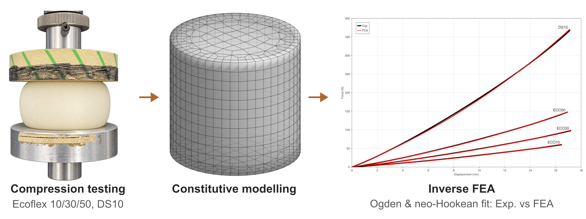

# Silicone_gel_inverse_FEA

## Summary
This repository is for inverse finite element analsysis (iFEA) for mechanical parameter identification of silicone gels. 

## License
This work is licensed under the [MIT license](LICENSE)
